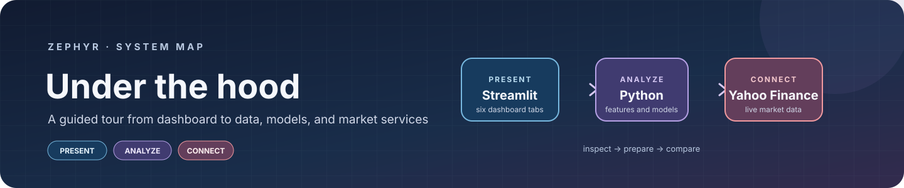
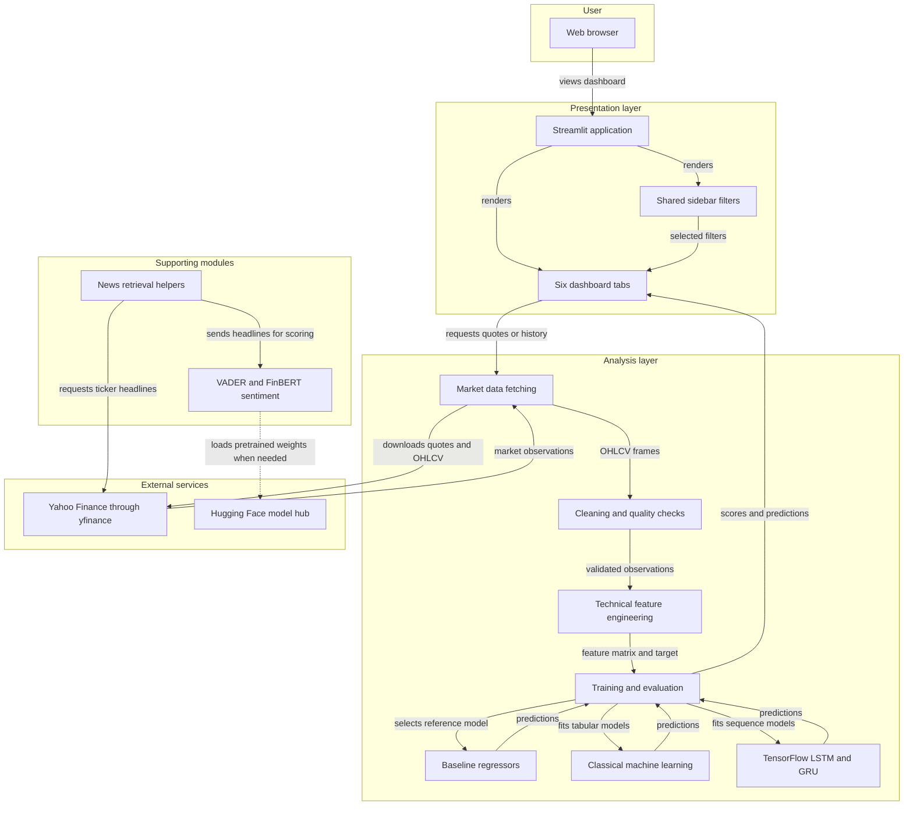
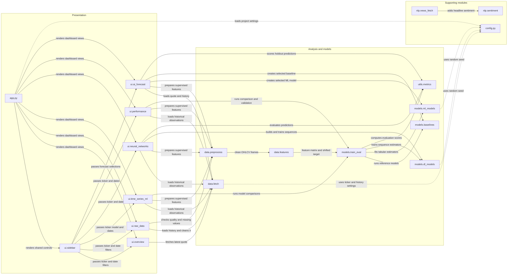

### A guided walk through the system behind the charts.

*Start at the dashboard. Follow a market-data request through the analysis modules, and see where models and external services join the story.*

> **Before the tour:** this is a map of the current code, not a proposed redesign. Market observations and predictions remain in application memory; the project does **not** configure a database or model-serving backend.

**THE SCREENS**　■ PRESENTATION　→　**THE WORKROOM**　■ ANALYSIS　→　**THE OUTSIDE WORLD**　■ SERVICES

<strong>Choose a path through the map</strong>

- [01 · The big picture](#application-architecture)
- [Technology stack](#technology-stack-summary)
- [Data storage and external services](#data-storage-amp-external-services)
- [Architectural choices](#key-architectural-decisions)
- [02 · A closer look at the components](#component-relationships)
- [Component inventory](#component-inventory)
- [Related guides](#related-guides)

<h2 align="center" id="application-architecture">01 · The big picture</h2>

Think of Zephyr as a small research room. A browser opens the screens; those screens request data and call the Python analysis modules; results return to the dashboard as tables, charts, and metrics. The top-level diagram follows that journey.

<!-- mermaid-checked: no \n, no em-dash/en-dash, no {} in labels, subgraphs are id["label"], arrows are -->|"label"|, all subgraphs closed by end, ids unique -->

<h3 align="center" id="technology-stack-summary">The tools in the room</h3>

| Layer | Technology | Version | Purpose |
|---|---|---|---|
| Presentation | Python | Not pinned | Application runtime and module implementation |
| Presentation | Streamlit | `>=1.32.0` | Interactive dashboard, sidebar controls, and tab navigation |
| Visualization | Plotly | `>=5.18.0` | Interactive price, comparison, and training charts |
| Data handling | pandas | `>=2.1.0` | OHLCV frames, feature tables, and data transformations |
| Data handling | NumPy | `>=1.26.0` | Numeric operations and model input arrays |
| Market data | yfinance | `>=0.2.36` | Yahoo Finance quotes, daily history, and supporting news retrieval |
| Feature analysis | ta | `>=0.11.0` | Technical-analysis dependency; feature code also computes rolling and lagged measures directly |
| Classical machine learning | scikit-learn | `>=1.4.0` | Preprocessing, regressors, chronological evaluation, and metrics |
| Classical machine learning | XGBoost | `>=2.0.0` | Optional gradient-boosted tree regressor |
| Classical machine learning | LightGBM | `>=4.3.0` | Optional gradient-boosted tree regressor |
| Deep learning | TensorFlow | `>=2.15.0` | LSTM and GRU sequence models |
| Sentiment analysis | vaderSentiment | `>=3.3.2` | Lightweight headline sentiment |
| Sentiment analysis | transformers and PyTorch | `>=4.38.0`; `>=2.1.0` | Optional FinBERT pipeline and model inference |

Versions shown are minimum constraints from `requirements.txt`, not a lockfile or guarantee of compatibility on every operating system.

<h3 align="center" id="data-storage-amp-external-services">Where the data goes</h3>

Yahoo Finance is accessed at runtime through `yfinance` for quotes, historical OHLCV observations, and supporting news retrieval. FinBERT can obtain pretrained model files from the Hugging Face model hub when sentiment analysis is invoked. **There is no database, message broker, or durable market-data store:** fetched data and model results are handled in application memory. The configured `artifacts` directory is created by the application, but the current dashboard does not use it as a persistent model registry.

<h3 align="center" id="key-architectural-decisions">Why the system is arranged this way</h3>

- **Modular Streamlit presentation:** `app.py` composes the shared sidebar and six focused tab renderers in `ui/`.
- **Separated analysis responsibilities:** fetching, cleaning, feature engineering, model factories, and evaluation live in distinct Python packages.
- **Time-aware evaluation:** supervised targets are shifted to the next observation and comparisons use chronological splits rather than shuffled samples.

<h2 align="center" id="component-relationships">02 · A closer look at the components</h2>

*Now zoom in from the rooms to the connections: which dashboard view calls which reusable module?*

<!-- mermaid-checked: no \n, no em-dash/en-dash, no {} in labels, subgraphs are id["label"], arrows are -->|"label"|, all subgraphs closed by end, ids unique -->

<h3 align="center" id="component-inventory">The component field guide</h3>

| Component | Layer | Type | Responsibility |
|---|---|---|---|
| `app.py` | Presentation | Streamlit entry point | Configures the page and renders the shared sidebar and six dashboard views |
| `ui.sidebar` | Presentation | Shared UI module | Collects region, ticker, date range, model, horizon, and refresh selections |
| `ui.overview` | Presentation | Dashboard view | Displays the latest quote, daily movement, and observation freshness |
| `ui.raw_data` | Presentation | Dashboard view | Displays OHLCV history, quality information, cleaning controls, and CSV download |
| `ui.time_series_ml` | Presentation | Dashboard view | Charts history and starts classical ML and baseline comparisons |
| `ui.neural_networks` | Presentation | Dashboard view | Prepares sequences, trains LSTM or GRU, and displays evaluation charts |
| `ui.performance` | Presentation | Dashboard view | Compares model metrics and optionally runs walk-forward validation |
| `ui.ai_forecast` | Presentation | Dashboard view | Generates a next-period estimate and shows holdout performance |
| `data.fetch` | Analysis | Data integration module | Retrieves quotes, daily OHLCV data, and records ticker fetch failures |
| `data.preprocess` | Analysis | Data preparation module | Sorts and cleans price observations, handles missing values, and reports quality |
| `data.features` | Analysis | Feature engineering module | Builds technical and lagged features and shifted supervised targets |
| `models.train_eval` | Analysis | Training and evaluation module | Performs chronological splits, model comparisons, metrics, and walk-forward validation |
| `models.baselines` | Analysis | Estimators | Provides last-close, last-return, and moving-average reference models |
| `models.ml_models` | Analysis | Model factory | Builds scikit-learn, XGBoost, and LightGBM regressors |
| `models.dl_models` | Analysis | Deep-learning module | Builds and trains LSTM and GRU sequence models |
| `utils.metrics` | Analysis | Metric helpers | Calculates MAE, RMSE, and directional accuracy |
| `nlp.news_fetch` | Supporting | News helper | Retrieves and deduplicates ticker headlines; not wired into the current dashboard |
| `nlp.sentiment` | Supporting | Sentiment helper | Scores headlines with VADER or optional FinBERT; not wired into the current dashboard |
| `config.py` | Supporting | Configuration module | Defines project metadata, ticker universe, refresh choices, feature windows, and model options |

> “Good architecture makes the route from observation to result easier to follow.”

For how the experiments work, read the [methodology](METHODOLOGY.md). For what those results cannot promise, see [limitations](LIMITATIONS.md).

 

[Back to the project README](README.md)

