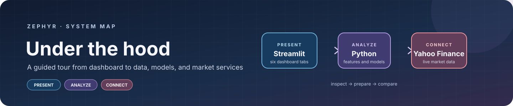
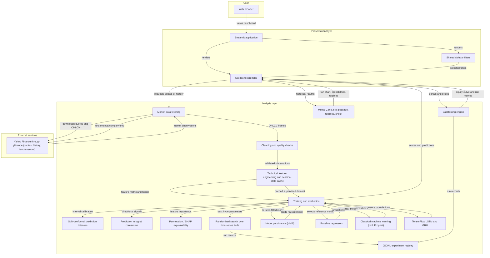
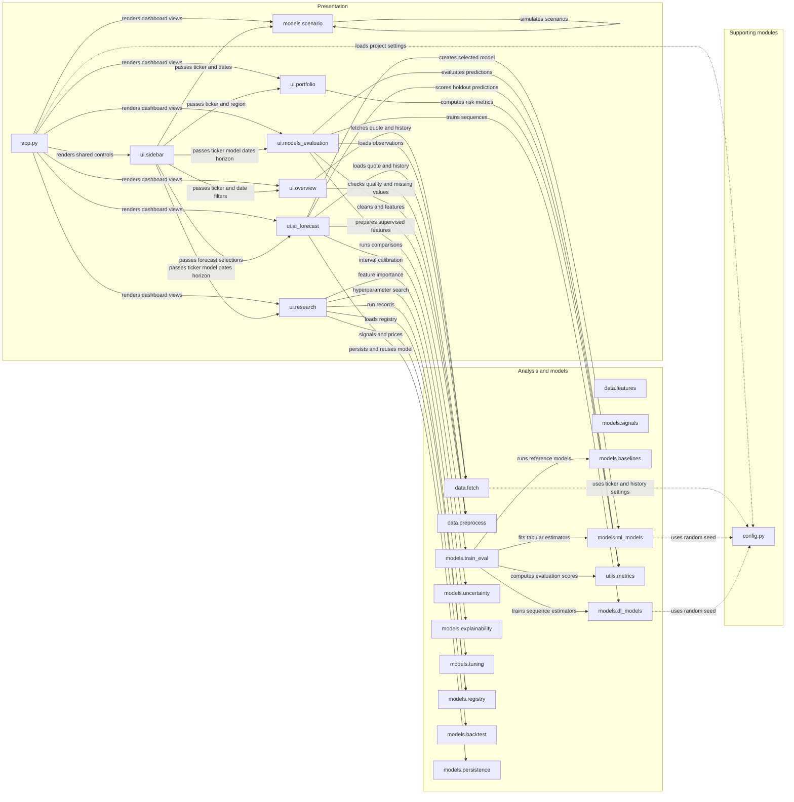

### A guided walk through the system behind the charts.

*Start at the dashboard. Follow a market-data request through the analysis modules, and see where models and external services join the story.*

> **Before the tour:** this is a map of the current code, not a proposed redesign. Market observations and predictions remain in application memory; the project does **not** configure a database or model-serving backend.

**THE SCREENS**　■ PRESENTATION　→　**THE WORKROOM**　■ ANALYSIS　→　**THE OUTSIDE WORLD**　■ SERVICES

<strong>Choose a path through the map</strong>

- [01 · The big picture](#application-architecture)
- [Technology stack](#technology-stack-summary)
- [Data storage and external services](#data-storage-amp-external-services)
- [Architectural choices](#key-architectural-decisions)
- [02 · A closer look at the components](#component-relationships)
- [Component inventory](#component-inventory)
- [Related guides](#related-guides)

<h2 align="center" id="application-architecture">01 · The big picture</h2>

Think of Zephyr as a small research room. A browser opens the screens; those screens request data and call the Python analysis modules; results return to the dashboard as tables, charts, and metrics. The top-level diagram follows that journey.

<!-- mermaid-checked: no \n, no em-dash/en-dash, no {} in labels, subgraphs are id["label"], arrows are -->|"label"|, all subgraphs closed by end, ids unique -->

<h3 align="center" id="technology-stack-summary">The tools in the room</h3>

| Layer | Technology | Version | Purpose |
|---|---|---|---|
| Presentation | Python | Not pinned | Application runtime and module implementation |
| Presentation | Streamlit | `>=1.32.0` | Interactive dashboard, sidebar controls, and tab navigation |
| Visualization | Plotly | `>=5.18.0` | Interactive price, comparison, and training charts |
| Data handling | pandas | `>=2.1.0` | OHLCV frames, feature tables, and data transformations |
| Data handling | NumPy | `>=1.26.0` | Numeric operations and model input arrays |
| Market data | yfinance | `>=0.2.36` | Yahoo Finance quotes, daily history, and fundamentals |
| Feature analysis | ta | `>=0.11.0` | Technical-analysis dependency; feature code also computes rolling and lagged measures directly |
| Classical machine learning | scikit-learn | `>=1.4.0` | Preprocessing, regressors, chronological evaluation, and metrics |
| Classical machine learning | XGBoost | `>=2.0.0` | Optional gradient-boosted tree regressor |
| Classical machine learning | LightGBM | `>=4.3.0` | Optional gradient-boosted tree regressor |
| Classical machine learning | Prophet | optional | Direct horizon-return regression wrapper |
| Deep learning | TensorFlow | `>=2.15.0` | LSTM and GRU sequence models |

Versions shown are minimum constraints from `requirements.txt`, not a lockfile or guarantee of compatibility on every operating system.

<h3 align="center" id="data-storage-amp-external-services">Where the data goes</h3>

Yahoo Finance is accessed at runtime through `yfinance` for quotes, historical OHLCV observations, and fundamental/company info. **There is no database, message broker, or durable market-data store:** fetched data and model results are handled in application memory. Trained classical ML models can be persisted to `artifacts/models/` through `models.persistence`, but persistence is a convenience cache, not a model registry with lineage or governance.

<h3 align="center" id="key-architectural-decisions">Why the system is arranged this way</h3>

- **Modular Streamlit presentation:** `app.py` composes the shared sidebar and seven focused tab renderers in `ui/`.
- **Separated analysis responsibilities:** fetching, cleaning, feature engineering, model factories, backtesting, persistence, and evaluation live in distinct Python packages.
- **Time-aware evaluation:** supervised targets cover the selected 1-, 3-, or 5-trading-day horizon and comparisons use chronological splits rather than shuffled samples.
- **Session-state cache:** engineered feature/target datasets are cached per (ticker, horizon, window) to avoid re-fetching across tab switches.
- **Model persistence:** fitted classical ML models are serialized to `artifacts/models/` and reused on subsequent forecast runs.

<h2 align="center" id="component-relationships">02 · A closer look at the components</h2>

*Now zoom in from the rooms to the connections: which dashboard view calls which reusable module?*

<!-- mermaid-checked: no \n, no em-dash/en-dash, no {} in labels, subgraphs are id["label"], arrows are -->|"label"|, all subgraphs closed by end, ids unique -->

<h3 align="center" id="component-inventory">The component field guide</h3>

| Component | Layer | Type | Responsibility |
|---|---|---|---|
| `app.py` | Presentation | Streamlit entry point | Configures the page and renders the shared sidebar and six dashboard views |
| `ui.sidebar` | Presentation | Shared UI module | Collects region, ticker, date range, model, horizon, and refresh selections |
| `ui.overview` | Presentation | Dashboard view | Displays the latest quote, daily movement, and observation freshness; includes a Data & Features section (OHLCV, quality, cleaning, CSV) |
| `ui.models_evaluation` | Presentation | Dashboard view | Candlestick, feature preview, classical ML comparison, neural-network training, and walk-forward evaluation via a segmented sub-nav |
| `ui.ai_forecast` | Presentation | Dashboard view | Generates a selected-horizon estimate with split-conformal prediction intervals and shows holdout performance |
| `ui.portfolio` | Presentation | Dashboard view | Multi-ticker correlation, normalized performance, risk summary, and fundamentals |
| `ui.research` | Presentation | Dashboard view | Explainability, hyperparameter tuning, backtesting, and the experiment registry via a segmented sub-nav |
| `ui.scenario` | Presentation | Dashboard view | Monte Carlo, first-passage probability, volatility regimes, and shock what-if via a segmented sub-nav |
| `data.fetch` | Analysis | Data integration module | Retrieves quotes, daily OHLCV data, fundamentals, and records ticker fetch failures |
| `data.preprocess` | Analysis | Data preparation module | Sorts and cleans price observations, handles missing values, and reports quality |
| `data.features` | Analysis | Feature engineering module | Builds technical and lagged features, shifted supervised targets, and session-state cache |
| `models.train_eval` | Analysis | Training and evaluation module | Performs chronological splits, model comparisons, metrics, and walk-forward validation |
| `models.uncertainty` | Analysis | Uncertainty module | Split-conformal prediction intervals, empirical coverage, and interval helpers |
| `models.signals` | Analysis | Signal module | Converts return predictions into directional trading signals (incl. non-overlapping stride mode) |
| `models.explainability` | Analysis | Explainability module | Permutation importance (always) and optional SHAP, with global and local explanations |
| `models.tuning` | Analysis | Tuning module | Randomized search over hyperparameters with time-series CV folds |
| `models.registry` | Analysis | Registry module | Append-only JSONL experiment registry (log, load, clear, summarize) |
| `models.scenario` | Analysis | Scenario module | Monte Carlo paths, first-passage probability, volatility regimes, and shock impact |
| `models.backtest` | Analysis | Backtesting engine | Simulates signals with transaction costs, slippage, position sizing, and stop-loss |
| `models.persistence` | Analysis | Model persistence | Saves and loads fitted models via joblib into `artifacts/models/` |
| `models.baselines` | Analysis | Estimators | Provides last-close, last-return, and moving-average reference models |
| `models.ml_models` | Analysis | Model factory | Builds scikit-learn, XGBoost, LightGBM, and Prophet regressors |
| `models.dl_models` | Analysis | Deep-learning module | Builds and trains LSTM and GRU sequence models |
| `utils.metrics` | Analysis | Metric helpers | Calculates MAE, RMSE, directional accuracy, Sharpe ratio, max drawdown, and VaR |
| `config.py` | Supporting | Configuration module | Defines project metadata, ticker universe, refresh choices, feature windows, model options, risk parameters, and the six-tab layout |

> “Good architecture makes the route from observation to result easier to follow.”

For how the experiments work, read the [methodology](METHODOLOGY.md). For what those results cannot promise, see [limitations](LIMITATIONS.md).

 

[Back to the project README](README.md)

