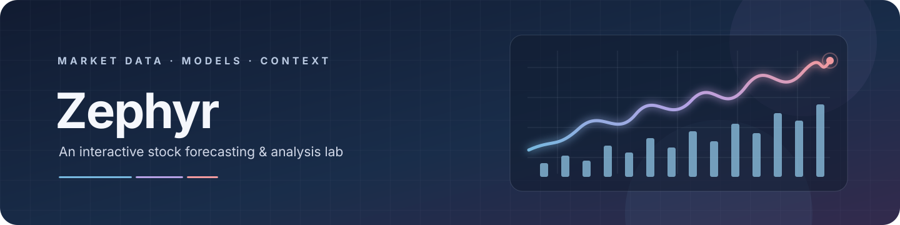

### The project has moved rooms.

*This changelog compares the current modular Zephyr dashboard with the earlier Streamlit application and research notebook supplied as references.*

**BEFORE**　→　**REWORKED**　→　**CURRENT**

> **Comparison note:** the earlier snapshot is the user-provided `streamlit.py` and `project2.ipynb`; the current snapshot is the repository examined on **2026-11-01**. The project configuration says version `1.0.0`; no release tags, commit dates, or official version-to-version release history were supplied. This is a source comparison, not a claim about a published release.

<strong>Choose a chapter</strong>

- [The shape of the change](#the-shape-of-the-change)
- [What changed across the project](#what-changed-across-the-project)
- [Dashboard and model comparison](#dashboard-and-model-comparison)
- [Notebook research compared with the current app](#notebook-research-compared-with-the-current-app)
- [Features no longer in the active dashboard](#features-no-longer-in-the-active-dashboard)
- [What is not claimed](#what-is-not-claimed)
- [Related guides](#related-guides)

<h2 align="center" id="the-shape-of-the-change">The shape of the change</h2>

The earlier app was a **single, all-in-one Streamlit script**, with broad interactive forecasting, market-analysis, news, and subscription features. The supplied notebook was a wide-ranging, multi-ticker research workspace. The current repository organizes the dashboard into UI, data, model, NLP, and utility modules, and makes its main forecasting workflow more explicitly about daily observations, feature-based next-period returns, and chronological evaluation.

That change is principally one of **structure and scope**. This comparison does not establish that the current models are more accurate, profitable, or reliable.

<h2 align="center" id="what-changed-across-the-project">What changed across the project</h2>

| Area | Earlier references | Current repository |
|---|---|---|
| Application shape | A large `streamlit.py` file contained page setup, fetching, analysis, model code, charts, news, and subscription handling. | `app.py` composes six `ui/` views; data, features, models, configuration, NLP, and metrics have separate packages. |
| Main market-data workflow | The dashboard loaded five years of daily history and also requested a one-minute live-price series with a 25-second cache. | Dashboard screens fetch daily history for a selected date range, defaulting to about two years; quotes and history are fetched through `yfinance`. |
| Ticker selection | Three technology-focused groups covering 23 listed symbols. | A configured, curated set across the United States, United Kingdom, Europe, and Australia. |
| Feature design | The notebook worked with a multi-ticker CSV and engineered grouped features such as moving averages, lagged closes, and direction labels. The app used close-price lags for selected models. | Reusable per-ticker features include returns and lags, moving averages, volatility, momentum, candle shape, and volume ratios; the target is shifted to the next observation's return. |
| Model organization | The app bundled several different model/task types into a “Train All 6” action; the notebook explored additional time-series, supervised, unsupervised, and neural-network methods. | Model factories and training utilities separate baseline, classical ML, and sequence-model experiments. |
| Evaluation | The old app reported MAE, RMSE, MAPE, R², and a direction score; the notebook included model metrics and analytical/statistical tests. | Shared comparison screens report MAE, RMSE, and return-direction accuracy on chronological holdouts; the Performance Metrics screen also offers walk-forward validation. |
| Documentation and tests | The supplied app and notebook were the main reference artifacts for the earlier workflow. | The repository includes focused data, feature, and metric tests plus README, architecture, methodology, and limitations guides. |

<h2 align="center" id="dashboard-and-model-comparison">Dashboard and model comparison</h2>

### The earlier app had seven tabs

The supplied `streamlit.py` provided Overview, Raw Data, Time Series + ML, Neural Networks, Performance Metrics, AI Forecast, and News & Sentiment. Its Overview included price, volume, market-cap and P/E context, moving averages, volatility, return distribution, and cumulative-return charts.

### The current app has six focused tabs

| Current tab | How it differs from the earlier app |
|---|---|
| **Overview** | Focuses on the latest available quote, daily change, volume, day range, exchange/region, and data age. |
| **Raw Data** | Adds explicit quality reporting, selectable missing-value handling, and a cleaned-history CSV download. |
| **Time Series + ML** | Uses engineered return features and compares selected baselines and classical regressors on a chronological split. |
| **Neural Networks** | Provides configurable LSTM/GRU sequence length and epochs, training/validation curves, and return predictions. |
| **Performance Metrics** | Uses MAE, RMSE, and directional accuracy for comparable return experiments, with optional expanding-window walk-forward validation; this differs from the earlier app's five-metric price-oriented scorecard. |
| **AI Forecast** | Trains the selected supported model for a single next-period return estimate and displays holdout metrics. |

### Model names are not a benchmark result

The earlier Streamlit app's “Train All 6 Models” action grouped LightGBM, Prophet, Random Forest, XGBoost, K-Means clustering, and an autoencoder experiment. The supplied notebook separately explored classical time-series methods, regressors, boosting, clustering, anomaly detection, dimensionality reduction, mixture models, and neural networks.

The current supervised dashboard instead offers last-close/last-return baselines, Random Forest, Extra Trees, HistGradientBoosting, XGBoost, LightGBM, and separate LSTM/GRU experiments. These model lists are **not directly comparable**: target definitions, features, samples, forecast horizons, and evaluation procedures changed. No numerical claim that one snapshot outperforms the other is made here.

> **Known current caveat:** the `NaiveLastClose` baseline is passed feature-only input in supervised screens and can read the first feature column rather than an observed close. See [Limitations](LIMITATIONS.md) before treating its score as a valid last-close reference.

<h2 align="center" id="notebook-research-compared-with-the-current-app">Notebook research compared with the current app</h2>

The supplied `project2.ipynb` was an 81-cell research notebook and expected a local `major-tech-stock-2019-2024.csv` file. Its work included:

- Multi-ticker cleaning and grouped feature engineering.
- Cross-stock comparisons, return/volatility summaries, and ticker correlations.
- ADF stationarity checks and SARIMA/Prophet experiments.
- Linear, Ridge, Lasso, Random Forest, LightGBM, and XGBoost regression experiments.
- K-Means, Isolation Forest, PCA, and Gaussian-mixture explorations.
- MLP, Keras neural-network, and wide-and-deep experiments.

The current dashboard is primarily a **single selected ticker at a time** and fetches its observations at runtime instead of depending on that notebook CSV. Some themes remain—feature engineering, chronological evaluation, tree models, and neural networks—but the current user interface does not reproduce the notebook's full cross-ticker, statistical, clustering, anomaly, or dimensionality-reduction analyses.

<h2 align="center" id="features-no-longer-in-the-active-dashboard">Features no longer in the active dashboard</h2>

The following features existed in the supplied earlier application but are **not available as equivalent active dashboard flows** in the current repository:

| Earlier capability | Current status |
|---|---|
| One-minute live-price ticker with short cache refresh | Replaced by latest-available quote/history retrieval and a data-age indicator; the current Overview is not a one-minute live feed. |
| Selectable 10–180 business-day forecast and lookback controls | Replaced by 1-, 3-, and 5-day sidebar selections; the forecast implementation itself produces a single next-period estimate rather than a multi-day path. |
| Multi-model future-price ensemble weighted by inverse MAE | Not present in the current AI Forecast screen. |
| Forecast-based BUY/SELL markers from moving-average crossovers | Not present. Current project output is educational model analysis, not a trading signal service. |
| Prophet-based future path in the Streamlit forecast tab | Not present in the current dashboard model workflow. Prophet appears in the supplied notebook and legacy app, but is not one of the current configured dashboard models. |
| Dedicated Investing.com news scraping and categorized VADER news cards | The current repository has separate `nlp/` helpers for Yahoo Finance headlines and VADER/FinBERT, but no News & Sentiment tab and no direct equivalent of the earlier scraper presentation. |
| Email newsletter subscription backed by Google Sheets | Not present in the current dashboard. |
| Notebook's CSV-backed cross-stock exploratory analyses | Not presented as current dashboard screens; the supplied source CSV is not part of the current project's runtime workflow. |

<h2 align="center" id="what-is-not-claimed">What is not claimed</h2>

- This file does not reconstruct a Git-based release timeline: the supplied earlier artifacts do not identify release dates or version numbers.
- It does not claim that removed features were all intentionally deprecated or that every experiment in the notebook produced a validated result.
- It does not compare historical model scores across snapshots. Their datasets, target types, splits, horizons, and model implementations are not a controlled match.
- It does not claim future returns, profitable strategies, or predictive improvements.

<h2 align="center" id="related-guides">Related guides</h2>

[README](README.md)　·　[Architecture](ARCHITECTURE.md)　·　[Methodology](METHODOLOGY.md)　·　[Limitations](LIMITATIONS.md)

Compared from the earlier user-provided app and notebook against the current repository snapshot.

