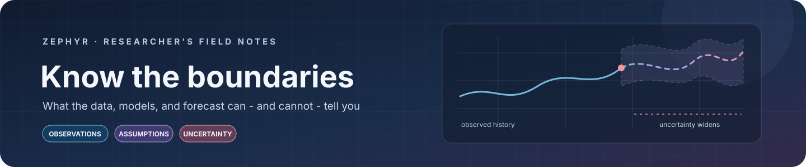

<div align="center">



### A clear boundary is part of a good forecast.

*These notes describe what this project actually observes, evaluates, and displays—and where interpretation should stop.*

</div>

<div align="center">

<span style="color:#77B8DF">■ DATA</span>　·　<span style="color:#B6A1E5">■ MODELS</span>　·　<span style="color:#F19A9F">■ INTERPRETATION</span>

</div>

> **Read this before relying on a number:** Zephyr is an educational stock-analysis project. It is not investment, trading, legal, or financial advice.

<details>
<summary><strong>In this field guide</strong></summary>

- [The short version](#the-short-version)
- [1 · The view through the data window](#1--the-view-through-the-data-window)
- [2 · The limits of the model room](#2--the-limits-of-the-model-room)
- [3 · The scoreboard is not a guarantee](#3--the-scoreboard-is-not-a-guarantee)
- [4 · What the forecast screen does not forecast](#4--what-the-forecast-screen-does-not-forecast)
- [5 · Context missing from the picture](#5--context-missing-from-the-picture)
- [6 · Practical and operational boundaries](#6--practical-and-operational-boundaries)
- [A careful way to use the dashboard](#a-careful-way-to-use-the-dashboard)
- [Related guides](#related-guides)

</details>

<h2 align="center" id="the-short-version">The short version</h2>

<div align="center">

| What Zephyr can help you do | What Zephyr cannot establish |
|---|---|
| Inspect selected historical OHLCV data | The future price or return of a security |
| Run educational, short-horizon model experiments | A reliable trading edge or expected profit |
| Compare outputs on historical holdouts | Future performance, certainty, or calibrated confidence |
| Explore a curated set of listed symbols | Complete, official, or universally current market coverage |

</div>

<h2 align="center" id="1--the-view-through-the-data-window">01 · The view through the data window</h2>

### An upstream source, not a market-data contract

The application requests market data through `yfinance` from Yahoo Finance. Data availability, symbol mappings, exchange coverage, timestamps, adjustment behavior, and quote delays are controlled by an external service. Responses can be incomplete, revised, delayed, or temporarily unavailable.

The configured list covers selected companies in four regions; it is **not** a comprehensive exchange listing, benchmark, or historically maintained universe. There is no survivorship-bias correction or historical membership reconstruction.

The dashboard's OHLCV fetcher defaults to `auto_adjust=True`. Historical OHLC values are therefore adjusted by the upstream library's behavior; they should not automatically be treated as raw, as-traded prices. Confirm data definitions before comparing sources or using the values in further research.

### Daily history is the displayed workflow

The dashboard requests daily OHLCV history. Although the fetch helper accepts intervals, the current user interface does not provide a complete intraday research workflow. Availability and retention for minute-level data would also depend on Yahoo Finance and the chosen symbol.

Quote freshness is an estimate based on whether the most recent returned observation is more than 24 hours old. This simple clock-based threshold is not an exchange calendar: weekends, holidays, regional market hours, and delayed feeds can affect what “stale” means in practice.

The Overview and AI Forecast views retrieve the latest quote independently of the selected historical date range. If you choose a past end date, the displayed “last observed price” can be newer than the observations used to train the model. Check the quote timestamp and date range before comparing them.

### Cleaning cannot recover missing history

The common model screens use limited forward filling for missing OHLCV values. A carried-forward value is not a replacement for the true missing observation. Feature engineering removes early rows without enough rolling history. It preserves the latest row's features for inference, while supervised evaluation excludes rows without enough future observations for the selected horizon. The effective sample can therefore be smaller than the selected date range suggests.

<h2 align="center" id="2--the-limits-of-the-model-room">02 · The limits of the model room</h2>

### Narrow inputs, narrow experiments

The supervised models use engineered OHLCV-derived inputs and a direct cumulative close-to-close return target over the selected 1-, 3-, or 5-trading-day horizon. They do not currently incorporate company fundamentals, macroeconomic variables, order-book data, transaction costs, or news sentiment.

The repository previously included VADER and FinBERT news-analysis helpers, but those modules and the News & Sentiment tab have been removed. **Forecasts are based purely on market data.**

### Baselines are return predictions

`NaiveLastClose` is represented as a zero-return forecast, equivalent to carrying the current close forward. `NaiveLastReturn` repeats the latest observed one-day return over the selected horizon. These are return baselines; they do not model execution costs or imply that holding a security is risk-free.

### Model availability and compute

XGBoost, LightGBM, and Prophet are treated as optional imports in the model factory; an unavailable library prevents that estimator from running. LSTM and GRU require a compatible TensorFlow installation and sufficient sequence data. SHAP-based explainability is optional (`pip install shap`); when unavailable, permutation importance is used instead.

### Explainability is an approximation

Permutation importance measures how much a feature's shuffle degrades holdout MAE. SHAP on a scaled `Pipeline([scaler, model])` is an approximation of the underlying estimator's attributions. Neither proves causality; a feature's importance reflects its correlation with the target under the training distribution, not a mechanism.

### Prediction intervals are approximate

The AI Forecast screen adds split-conformal prediction intervals calibrated on the chronological holdout. Coverage is finite-sample approximate and can degrade under distribution shift, regime change, or non-exchangeable data. A band on a chart is **not a calibrated confidence statement** about the future.

### Backtest and signal caveats

The Research hub exposes the backtest engine with transaction costs, slippage, position sizing, and an optional stop-loss. Model predictions are produced per forecast origin over the selected horizon, then traded as a consecutive daily signal series; this overlapping-horizon treatment is an approximation. The non-overlapping **stride** mode (stride = horizon) reduces that overlap. Backtesting is a historical simulation, not live paper trading, and not a profitability guarantee.

### Scenario Lab is descriptive, not predictive

Monte Carlo paths resample the historical return distribution (or a GBM fit); they model the past, not the future, and cannot anticipate regime change, news, or structural breaks. First-passage target/stop probabilities are derived from those simulated paths. Volatility regimes are descriptive rolling-volatility quantile labels, not a predictive model. Shock what-if recovery times are estimated from historical days with comparable drops and can be faster, slower, or never.

### Model persistence

Trained classical ML models may be serialized to `artifacts/models/` via joblib and reused across sessions. Persistence is a convenience cache: it does not provide model versioning, lineage, drift monitoring, or production governance. A stored model reflects the data and hyperparameters at the time it was trained; retrain when the observation window or settings change.

### Session-state caching

Engineered feature/target datasets are cached in Streamlit session state per (ticker, horizon, date window) to avoid re-fetching across tab switches. Cached data reflects the fetch time and upstream response at cache creation; it is not refreshed automatically within a session and does not persist across browser restarts.

The model settings are experiment defaults, not a hyperparameter search. Scores depend on data, preprocessing, model settings, installed package versions, and random variation. Dependency declarations specify minimum versions rather than a lockfile.

<h2 align="center" id="3--the-scoreboard-is-not-a-guarantee">03 · The scoreboard is not a guarantee</h2>

### Historical evaluation has a limited reach

The standard comparison uses a chronological holdout (80% training and 20% test by default; the Performance Metrics screen allows 10%–40% test size). This prevents random shuffling across time, but a single historical period is not an independent guarantee of future performance. Repeatedly choosing a model after inspecting holdout results can also make that holdout less informative.

Optional walk-forward evaluation uses expanding chronological folds for supported classical machine-learning models. It is an additional historical check, not a live paper-trading study, prospective test, or assurance that market regimes will remain stable.

The LSTM/GRU screen fits a standard scaler to training features and reserves a validation tail of its training sequences. Test sequences are built within the test partition, so the first `sequence length` observations supply context rather than scored predictions. Metrics can therefore cover fewer observations than the raw holdout.

### Metrics omit useful context

| Metric | What it summarizes | What it does not tell you |
|---|---|---|
| **MAE** | Mean absolute prediction error | Whether the model is profitable after execution costs |
| **RMSE** | Error with additional weight on larger misses | Whether errors are acceptable for a particular risk tolerance |
| **Directional accuracy** | Sign matches for non-zero actual returns | The size, timing, or economic value of a move |
| **Sharpe ratio** | Mean excess return per unit of volatility, annualized | Whether the return stream is tradable or robust to regime change |
| **Maximum drawdown** | Largest peak-to-trough decline in cumulative equity | The path of losses or recovery time |
| **Value at Risk** | Historical percentile loss at the configured confidence level | Tail risk beyond the percentile or expected shortfall |

Directional accuracy ignores zero actual returns. The dashboard does not calculate calibrated uncertainty beyond the approximate conformal band, or economic value after execution costs. A chart or score is **not a confidence estimate**.

<h2 align="center" id="4--what-the-forecast-screen-does-not-forecast">04 · What the forecast screen does not forecast</h2>

### A horizon estimate is not a daily forecast path

The sidebar offers **1-, 3-, and 5-trading-day** horizons. For each choice, the model estimates the cumulative close-to-close return from the forecast origin to that horizon. It does not recursively generate a sequence of daily predictions. A direct horizon estimate is not a validated trading strategy or a guarantee of future performance.

The implied price is illustrative arithmetic:

```text
latest quote × (1 + predicted horizon return)
```

It is not a target price, probability range, confidence interval, or guaranteed future quote.

### Model selection in the forecast tab has a different scope

The AI Forecast screen supports the listed baseline and classical ML branches, plus an approximate split-conformal interval. Selecting LSTM or GRU in the shared sidebar does not train a neural network in that screen; unsupported selections are routed to an XGBoost fallback. That fallback also depends on XGBoost being installed. Use the Models & Evaluation tab to run its separate LSTM/GRU experiment.

<h2 align="center" id="5--context-missing-from-the-picture">05 · Context missing from the picture</h2>

The current analysis does not account for:

- Real-time execution: brokerage fees, bid–ask spread, slippage, liquidity, taxes, and timing are only approximated in the backtest engine, not applied to live forecasts.
- Portfolio weights, diversification, leverage, and risk controls beyond the Portfolio screen's equal-weight aggregation.
- Fundamentals are displayed in the Portfolio screen but are **not features** in the return-forecast models.
- Regime-change detection is descriptive only (volatility regimes); there is no predictive regime model.
- Guarantees that historical patterns persist; Scenario Lab outputs are descriptive models of the past.
- A production monitoring, alerting, authentication, or multi-user data-isolation design.

The app is a local educational dashboard, not a hardened portfolio or financial-services platform. Treat deployment and access controls as separate engineering work before exposing it beyond a trusted local environment.

<h2 align="center" id="6--practical-and-operational-boundaries">06 · Practical and operational boundaries</h2>

- **Internet required:** quotes and history are fetched at runtime; there is no offline market-data snapshot bundled with the application.
- **Optional assets:** SHAP can require a first-use import/download; install with `pip install shap` (permutation importance works without it).
- **Performance varies:** training time and memory use depend on the machine, data span, and model, especially for neural networks, SHAP, and hyperparameter tuning.
- **Experiment registry is lightweight:** runs are appended to `artifacts/experiments/experiments.jsonl`; there is no rotation or database. Clear old records periodically.
- **Reproducing a run takes notes:** capture the ticker, date range, observation timestamp, missing-data policy, model, parameters, test fraction, and package environment.

<h2 align="center" id="a-careful-way-to-use-the-dashboard">A careful way to use the dashboard</h2>

<div align="center">

**Inspect the source data**　→　**Compare against a verified baseline**　→　**Read the prediction plot**　→　**Check the dates and assumptions**　→　**Keep financial decisions separate**

</div>

> “A limitation is not a footnote to the result. It is part of the result.”

<h2 align="center" id="related-guides">Related guides</h2>

<div align="center">

[Architecture](ARCHITECTURE.md)　·　[Methodology](METHODOLOGY.md)　·　[Project README](README.md)

<sub>Educational use only. Not financial advice.</sub>

</div>