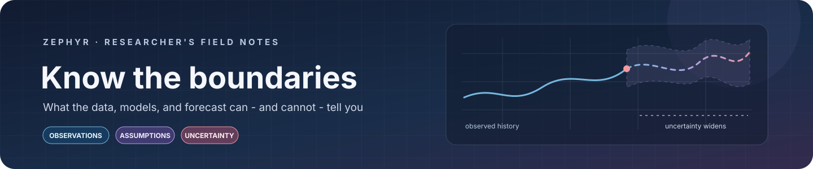

<div align="center">



### A clear boundary is part of a good forecast.

*These notes describe what this project actually observes, evaluates, and displays—and where interpretation should stop.*

</div>

<div align="center">

<span style="color:#77B8DF">■ DATA</span>　·　<span style="color:#B6A1E5">■ MODELS</span>　·　<span style="color:#F19A9F">■ INTERPRETATION</span>

</div>

> **Read this before relying on a number:** Zephyr is an educational stock-analysis project. It is not investment, trading, legal, or financial advice.

<details>
<summary><strong>In this field guide</strong></summary>

- [The short version](#the-short-version)
- [1 · The view through the data window](#1--the-view-through-the-data-window)
- [2 · The limits of the model room](#2--the-limits-of-the-model-room)
- [3 · The scoreboard is not a guarantee](#3--the-scoreboard-is-not-a-guarantee)
- [4 · What the forecast screen does not forecast](#4--what-the-forecast-screen-does-not-forecast)
- [5 · Context missing from the picture](#5--context-missing-from-the-picture)
- [6 · Practical and operational boundaries](#6--practical-and-operational-boundaries)
- [A careful way to use the dashboard](#a-careful-way-to-use-the-dashboard)
- [Related guides](#related-guides)

</details>

<h2 align="center" id="the-short-version">The short version</h2>

<div align="center">

| What Zephyr can help you do | What Zephyr cannot establish |
|---|---|
| Inspect selected historical OHLCV data | The future price or return of a security |
| Run educational, short-horizon model experiments | A reliable trading edge or expected profit |
| Compare outputs on historical holdouts | Future performance, certainty, or calibrated confidence |
| Explore a curated set of listed symbols | Complete, official, or universally current market coverage |

</div>

<h2 align="center" id="1--the-view-through-the-data-window">01 · The view through the data window</h2>

### An upstream source, not a market-data contract

The application requests market data through `yfinance` from Yahoo Finance. Data availability, symbol mappings, exchange coverage, timestamps, adjustment behavior, and quote delays are controlled by an external service. Responses can be incomplete, revised, delayed, or temporarily unavailable.

The configured list covers selected companies in four regions; it is **not** a comprehensive exchange listing, benchmark, or historically maintained universe. There is no survivorship-bias correction or historical membership reconstruction.

The dashboard's OHLCV fetcher defaults to `auto_adjust=True`. Historical OHLC values are therefore adjusted by the upstream library's behavior; they should not automatically be treated as raw, as-traded prices. Confirm data definitions before comparing sources or using the values in further research.

### Daily history is the displayed workflow

The dashboard requests daily OHLCV history. Although the fetch helper accepts intervals, the current user interface does not provide a complete intraday research workflow. Availability and retention for minute-level data would also depend on Yahoo Finance and the chosen symbol.

Quote freshness is an estimate based on whether the most recent returned observation is more than 24 hours old. This simple clock-based threshold is not an exchange calendar: weekends, holidays, regional market hours, and delayed feeds can affect what “stale” means in practice.

The Overview and AI Forecast views retrieve the latest quote independently of the selected historical date range. If you choose a past end date, the displayed “last observed price” can be newer than the observations used to train the model. Check the quote timestamp and date range before comparing them.

### Cleaning cannot recover missing history

The common model screens use limited forward filling for missing OHLCV values. A carried-forward value is not a replacement for the true missing observation. Feature engineering also removes early rows without enough rolling history and the final row without a next-observation target. The effective sample can therefore be smaller than the selected date range suggests.

<h2 align="center" id="2--the-limits-of-the-model-room">02 · The limits of the model room</h2>

### Narrow inputs, narrow experiments

The supervised models use engineered OHLCV-derived inputs and a next-observation return target. They do not currently incorporate company fundamentals, macroeconomic variables, order-book data, transaction costs, or news sentiment.

The repository includes VADER and FinBERT news-analysis helpers, but the News & Sentiment tab was removed. **Those sentiment outputs are not features in the live dashboard forecasts.**

### A baseline that needs special caution

> **⚠️ `NaiveLastClose` is not a trustworthy last-close reference in the current supervised screens.**

The supervised dataset passes feature-only columns to the baseline, not a DataFrame containing `Close`. When `NaiveLastClose` cannot find that column, its implementation reads the first feature column instead. In the current feature order, that is `return_1d`; the prediction target is a next-observation return. The resulting score is therefore **not a valid last-close or zero-return baseline**, despite the model name and docstring.

Treat its entries in model comparisons and AI Forecast as affected by this implementation mismatch. Compare other models to an independently verified reference until the baseline implementation is corrected.

### Model availability and compute

XGBoost and LightGBM are treated as optional imports in the model factory; an unavailable library prevents that estimator from running. LSTM and GRU require a compatible TensorFlow installation and sufficient sequence data. FinBERT requires compatible Transformers/PyTorch dependencies and may download model files on first use.

The model settings are experiment defaults, not a hyperparameter search. Scores depend on data, preprocessing, model settings, installed package versions, and random variation. Dependency declarations specify minimum versions rather than a lockfile.

<h2 align="center" id="3--the-scoreboard-is-not-a-guarantee">03 · The scoreboard is not a guarantee</h2>

### Historical evaluation has a limited reach

The standard comparison uses a chronological holdout (80% training and 20% test by default; the Performance Metrics screen allows 10%–40% test size). This prevents random shuffling across time, but a single historical period is not an independent guarantee of future performance. Repeatedly choosing a model after inspecting holdout results can also make that holdout less informative.

Optional walk-forward evaluation uses expanding chronological folds for supported classical machine-learning models. It is an additional historical check, not a live paper-trading study, prospective test, or assurance that market regimes will remain stable.

The LSTM/GRU screen fits a standard scaler to training features and reserves a validation tail of its training sequences. Test sequences are built within the test partition, so the first `sequence length` observations supply context rather than scored predictions. Metrics can therefore cover fewer observations than the raw holdout.

### Metrics omit useful context

| Metric | What it summarizes | What it does not tell you |
|---|---|---|
| **MAE** | Mean absolute prediction error | Whether the model is profitable after execution costs |
| **RMSE** | Error with additional weight on larger misses | Whether errors are acceptable for a particular risk tolerance |
| **Directional accuracy** | Sign matches for non-zero actual returns | The size, timing, or economic value of a move |

Directional accuracy ignores zero actual returns. The dashboard does not calculate trading returns, confidence intervals, calibrated uncertainty, drawdown, risk-adjusted performance, or prediction intervals. A chart or score is **not a confidence estimate**.

<h2 align="center" id="4--what-the-forecast-screen-does-not-forecast">04 · What the forecast screen does not forecast</h2>

### Its multi-day horizon control does not roll forward

The sidebar offers **1-, 3-, and 5-day** horizon choices. The AI Forecast screen, however, estimates a single next-observation return. It does not recursively generate a 3-day or 5-day path. The displayed horizon should **not** be read as a validated multi-day prediction.

The implied price is illustrative arithmetic:

```text
latest quote × (1 + predicted next-observation return)
```

It is not a target price, probability range, confidence interval, or guaranteed future quote.

### Model selection in the forecast tab has a different scope

The AI Forecast screen supports the listed baseline and classical ML branches. Selecting LSTM or GRU in the shared sidebar does not train a neural network in that screen; unsupported selections are routed to an XGBoost fallback. That fallback also depends on XGBoost being installed. Use the Neural Networks tab to run its separate LSTM/GRU experiment.

<h2 align="center" id="5--context-missing-from-the-picture">05 · Context missing from the picture</h2>

The current analysis does not account for:

- Brokerage fees, bid–ask spread, slippage, liquidity, taxes, or execution timing.
- Portfolio weights, diversification, leverage, position sizing, or risk controls.
- Fundamentals, company events, macroeconomic announcements, or a functioning news-sentiment feature pipeline.
- Regime-change detection, stress scenarios, or guarantees that historical patterns persist.
- A production monitoring, alerting, authentication, or multi-user data-isolation design.

The app is a local educational dashboard, not a hardened portfolio or financial-services platform. Treat deployment and access controls as separate engineering work before exposing it beyond a trusted local environment.

<h2 align="center" id="6--practical-and-operational-boundaries">06 · Practical and operational boundaries</h2>

- **Internet required:** quotes and history are fetched at runtime; there is no offline market-data snapshot bundled with the application.
- **External model assets:** FinBERT can require a first-use model download and additional disk space.
- **Performance varies:** training time and memory use depend on the machine, data span, and model, especially for neural networks.
- **Results are transient:** the dashboard runs experiments in memory and does not provide a persistent experiment registry or reproducibility archive.
- **Reproducing a run takes notes:** capture the ticker, date range, observation timestamp, missing-data policy, model, parameters, test fraction, and package environment.

<h2 align="center" id="a-careful-way-to-use-the-dashboard">A careful way to use the dashboard</h2>

<div align="center">

**Inspect the source data**　→　**Compare against a verified baseline**　→　**Read the prediction plot**　→　**Check the dates and assumptions**　→　**Keep financial decisions separate**

</div>

> “A limitation is not a footnote to the result. It is part of the result.”

<h2 align="center" id="related-guides">Related guides</h2>

<div align="center">

[Architecture](ARCHITECTURE.md)　·　[Methodology](METHODOLOGY.md)　·　[Project README](README.md)

<sub>Educational use only. Not financial advice.</sub>

</div>