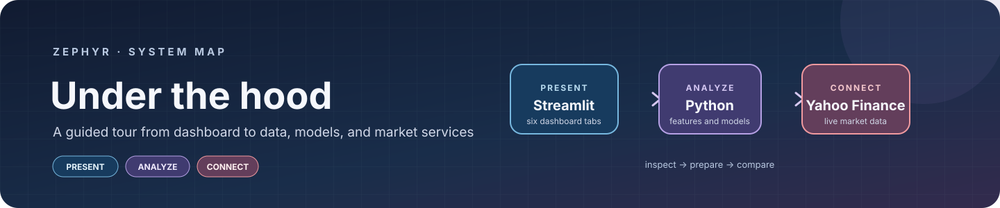

<div align="center">



### A forecast is the last step, not the first.

*This document follows one research session from market observation to model evaluation, and records the assumptions along the way.*

</div>

<div align="center">

**OBSERVE**　→　**PREPARE**　→　**ENGINEER**　→　**TEST**　→　**INTERPRET**

</div>

> **Scope:** Zephyr is an educational forecasting and analysis project. Its results are exploratory and are **not financial advice** or a recommendation to buy or sell a security.

## 01 · Begin with an observation

A research session starts with a configured ticker and date range selected in the Streamlit sidebar. The app retrieves quotes or historical OHLCV data through `yfinance`, which accesses Yahoo Finance.

OHLCV means **open, high, low, close, and volume**. Observations are requested as daily history by the dashboard. The source is external: symbols, coverage, timestamps, adjustment behavior, availability, and delays are governed by Yahoo Finance and can change.

The configured ticker universe contains selected listings in the United States, United Kingdom, Europe, and Australia. It is a sample universe rather than an exhaustive market index.

## 02 · Inspect and prepare the record

Before creating model inputs, the data utilities:

1. Standardize the time index, sort observations chronologically, and keep the last row for duplicate timestamps.
2. Convert available OHLCV fields to numeric values and remove rows with non-positive OHLC prices.
3. Apply a missing-data policy where the calling screen requests it. Most model screens use limited forward fill; the Raw Data screen exposes forward-fill, drop, and no-fill choices.
4. Report basic data quality, including row count, date span, and missing-cell percentage.

Cleaning choices affect the resulting sample. In particular, forward filling carries an earlier observation into a later missing value; it does not reconstruct the unobserved market event. Inspect the Raw Data view and quality summary before interpreting a model result.

## 03 · Turn history into features

The feature pipeline computes numeric indicators from observed OHLCV columns. Configured rolling windows are 5, 10, 20, and 50 observations for moving averages; default volatility and momentum windows are 20 and 10 observations.

| Feature family | Examples implemented in `data/features.py` |
|---|---|
| Returns | One-period percentage return and log return |
| Return history | Lagged one-period returns at lags 1, 2, 3, and 5 |
| Trend | Simple and exponential moving averages; normalized distance from simple moving averages |
| Volatility | Rolling standard deviation of returns and annualized volatility using √252 |
| Momentum | Close-to-close change over the configured momentum window |
| Candle shape | Daily range, body, upper shadow, and lower shadow |
| Volume | One-period volume change, a 20-period volume average, and volume ratio |
| Longer range | Rolling high/low and distance from those levels when sufficient history is present |

### Define the prediction target

The primary supervised-learning target is the **cumulative close-to-close return over the selected 1-, 3-, or 5-trading-day horizon**:

```text
target_return_h[t] = Close[t + h] / Close[t] - 1
```

The feature row at time *t* is paired with the close-to-close return at the selected horizon. Rows without enough future observations are excluded from supervised evaluation, while the newest complete feature row remains available for inference.

The feature selector excludes raw OHLCV columns, ticker and region metadata, and target columns. Rolling operations are computed over the ordered history; initial rows that lack the required history are removed when `dropna=True`.

> **No-lookahead intention:** the feature pipeline uses historical rolling and lagged values, and shifts the prediction target forward. This is a design constraint, not proof that every user-selected range or upstream data condition is free of every possible form of leakage.

## 04 · Establish a time-aware test

For the standard comparison, the dataset is split **without shuffling**: the first 80% of observations form the training set and the final 20% form the holdout. A gap equal to the selected forecast horizon separates the partitions, preventing training labels from overlapping the test period. The Performance Metrics screen allows a test fraction between 10% and 40%.

For optional walk-forward evaluation, the project uses scikit-learn `TimeSeriesSplit` with five splits by default and the same horizon-sized gap. Each fold fits on an earlier time segment and scores a later segment; the results are summarized across folds.

### Neural-network sequence preparation

The Neural Networks screen splits the feature rows chronologically, standardizes features with a `StandardScaler` fitted on the training partition, then forms rolling sequences. It offers LSTM and GRU, a sequence length from 10 to 60 observations, and 10 to 100 training epochs. Training reserves the last 15% of the training sequences for validation and uses early stopping with restored best weights.

For sequence models, the test sequences are formed from the test partition itself. The first `sequence length` test observations are therefore consumed as sequence context rather than scored as prediction targets. The effective number of scored test predictions is smaller than the raw holdout.

## 05 · Compare model families

Experiments can compare simple references, classical regressors, and sequence models on return targets:

| Family | Available models | What the comparison tells you |
|---|---|---|
| Baseline | `NaiveLastClose`, `NaiveLastReturn` | How a simple reference performs on the same split |
| Classical machine learning | `RandomForest`, `ExtraTrees`, `HistGradientBoosting`, `XGBoost`, `LightGBM` | How tree-based regressors fit the engineered features |
| Deep learning | `LSTM`, `GRU` | How sequence models perform on ordered feature windows |

`XGBoost` and `LightGBM` are imported optionally in the model module. If an optional library cannot be imported, a run that selects that estimator can report an error rather than produce a score.

## 06 · Read the scorecard carefully

| Metric | Interpretation | Direction to prefer |
|---|---|---|
| **MAE** | Mean absolute difference between predicted and actual target returns | Lower |
| **RMSE** | Square root of mean squared prediction error; larger errors receive more weight | Lower |
| **Directional accuracy** | Percentage of non-zero actual returns for which predicted and actual signs match | Higher |

The app also plots predicted and actual returns and, where available, model training and validation curves. Metrics depend on the chosen ticker, observation window, split, features, estimator settings, and upstream data. A model ranking on one historical holdout does not establish that it will outperform on future observations.

> **A useful reading habit:** compare every complex model to a baseline, check the size and time span of the holdout, and look at the prediction chart instead of interpreting a single summary metric in isolation.

## 07 · From score to displayed forecast

The AI Forecast screen fits the selected baseline or classical ML model on the training partition, reports its holdout metrics, then estimates the selected horizon's cumulative return from the latest feature row. It displays the latest quote as context and calculates an illustrative implied price as:

```text
illustrative price = latest quote × (1 + predicted horizon return)
```

This value is a model output, not a price target, confidence interval, or guaranteed future quote.

### An important interface limitation

The sidebar exposes 1-, 3-, and 5-day horizon choices, but the AI Forecast implementation does not recursively generate a path or otherwise extend the model prediction across the selected number of days. Treat the shown horizon as a user selection, **not a validated multi-day forecast**.

Selecting LSTM or GRU in the shared model control does not train a neural network inside the AI Forecast screen; neural-network experiments are handled in the separate Neural Networks tab. In the forecast screen, other unsupported selections fall back to XGBoost, which must be installed.

## 08 · News and sentiment are a separate experiment

The repository includes helpers to retrieve ticker headlines through `yfinance` and analyze headline text with VADER or FinBERT. These modules are **not connected to the current six-tab dashboard** and are not inputs to its displayed return forecasts. FinBERT may download pretrained files on first use and requires compatible `transformers` and PyTorch installations.

## 09 · Reproduce an experiment

Run the app from an installed project environment:

```powershell
python -m streamlit run app.py
```

For a reproducible comparison, record the ticker, date range, data retrieval time, preprocessing choice, model, sequence settings where applicable, test fraction, and metric results. The project pins a random seed in configuration for supported model components, but package versions are expressed as minimums and no dependency lockfile is provided.

## Boundaries worth keeping in view

- Market prices are uncertain and affected by events absent from historical features.
- Third-party quote and news data can be delayed, incomplete, revised, or unavailable.
- A chronological holdout and walk-forward scores provide historical evidence, not a performance guarantee.
- Directional accuracy can be close to chance, and aggregate metrics can hide periods of failure.
- The project does not include fees, slippage, portfolio construction, position sizing, or a full trading simulation.
- Outputs are educational and experimental; they are not financial, investment, or trading advice.

<div align="center">

**The method is a map, not the territory.**

<sub>Observe carefully. Test in time order. Treat every forecast as uncertain.</sub>

</div>