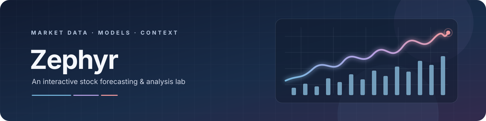
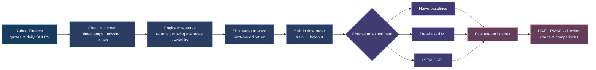

<div align="center">



<br>

### The market opens. The questions begin.

**One ticker. A trail of evidence. A forecast that still has to earn your trust.**

*Step into a small research room where every chart starts with data, every model faces a test, and no prediction gets the final word.*

[↗ Open the live Zephyr dashboard](https://stockmarketanalysis-ljamupzbn5isxz5tnngeis.streamlit.app/)

[Explore the app](#launch-zephyr) · [See the workflow](#market-data-to-model-score) · [Read the fine print](#data-models-and-limitations)

<br>

`Python` &nbsp;·&nbsp; `Streamlit` &nbsp;·&nbsp; `Plotly` &nbsp;·&nbsp; `scikit-learn` &nbsp;·&nbsp; `TensorFlow`

</div>

<br>

<div align="center">

> **⚠️ Educational research only · Not financial advice**
>
> Forecasts are experimental, can be wrong, and should not be used as the basis for financial decisions.

</div>

<details>
<summary><strong>Quick navigation</strong>　(⌘ / Ctrl + click a section)</summary>

- [Step into the market lab](#the-idea)
- [Six stops along the investigation](#what-you-can-explore)
- [Follow the evidence](#market-data-to-model-score)
- [Open the lab](#launch-zephyr)
- [Find your way around the project](#project-map)
- [Go beyond the dashboard](#beyond-the-dashboard)
- [Changelog](CHANGELOG.md)
- [Forecast limitations](LIMITATIONS.md)
- [Check the experiments](#tests)
- [The researcher's field notes](#data-models-and-limitations)
- [The side room: news and sentiment](#news-and-sentiment-modules)
- [License](#license)

</details>

<h2 align="center" id="the-idea">✦ Step into the market lab</h2>

Imagine opening the lab before making up your mind about a stock. **Zephyr** is a Streamlit dashboard that lets you follow the evidence: choose a company, look at its available market history, turn observations into technical features, and see how forecasting experiments perform on data they did not train on.

This is not a story where the model knows the ending. It is a place to ask better questions, compare a simple baseline with more complex models, and notice where predictions miss. Scores and test-set charts belong together; **a forecast is a clue, not a conclusion.** (｡•̀ᴗ-)✧

<h3 align="center">Every research session starts with a question</h3>

| Question | Where to look |
|---|---|
| What does the latest available quote look like? | **Overview** |
| What observations are being analyzed? | **Raw Data** |
| What patterns can features and classic models capture? | **Time Series + ML** |
| How do neural networks and model scores compare? | **Neural Networks** · **Performance Metrics** |
| What does the selected model estimate for the next period? | **AI Forecast** |

<h2 align="center" id="what-you-can-explore">◈ Six stops along the investigation</h2>

The sidebar is your field notebook: choose a region, pick a ticker, set a date range, and select a model. From there, each tab reveals another part of the investigation.

| Dashboard area | What it shows | Models / methods |
|---|---|---|
| **01 · Overview** | Latest available price, daily change, volume, day range, exchange, region, and data age | Yahoo Finance quote/history |
| **02 · Raw Data** | Daily OHLCV history, missing-data summary, cleaning options, and a downloadable CSV | Forward-fill, drop, or leave missing values unchanged |
| **03 · Time Series + ML** | Candlestick chart, feature preview, model comparison, and MAE chart | Naive baselines, Random Forest, Extra Trees, HistGradientBoosting, XGBoost, LightGBM |
| **04 · Neural Networks** | Train/test metrics, loss curves, and predicted-versus-actual returns | LSTM or GRU |
| **05 · Performance Metrics** | Model ranking, MAE and directional-accuracy charts, optional walk-forward scores | Chronological holdout; optional expanding-window validation |
| **06 · AI Forecast** | Holdout metrics, an illustrative next-period return and price, and test-set comparison | Selected baseline or classical ML model |

<p>


</p>

### 🌐 The map on the wall

The map is selective rather than complete. Browse the configured companies by region, or choose from the combined ticker list.

| Region | Example symbols |
|---|---|
| United States | `AAPL` · `MSFT` · `NVDA` · `JPM` |
| United Kingdom | `AZN.L` · `SHEL.L` · `HSBA.L` |
| Europe | `ASML.AS` · `SAP.DE` · `NESN.SW` |
| Australia | `CBA.AX` · `BHP.AX` · `CSL.AX` |

> **A note on the horizon control:** the sidebar offers 1-, 3-, and 5-day selections, but the current AI Forecast implementation predicts a **next-period return**; it does not recursively generate a multi-day path. Treat the displayed horizon as UI context, <mark style="background-color:#473B67;color:#F5F7FC;">not a validated multi-day forecast</mark>.

<h2 align="center" id="market-data-to-model-score">⤷ Follow the evidence</h2>

The journey begins with market observations, not a prediction. Clean the record, build features from what was available at the time, then hold back later observations for the test. Only after that does the model get its turn.



<h3 align="center">Three kinds of voices in the room</h3>

| Family | Available choices | Purpose |
|---|---|---|
| **The baseline** | `NaiveLastClose`, `NaiveLastReturn` | The quiet starting point: can a simple reference already do well? |
| **The tree models** | `RandomForest`, `ExtraTrees`, `HistGradientBoosting`, `XGBoost`, `LightGBM` | Several ways of learning patterns from engineered features |
| **The sequence models** | `LSTM`, `GRU` | Neural-network experiments that read ordered sequences |

The scorecard reports mean absolute error (**MAE**), root mean squared error (**RMSE**), and **directional accuracy** (how often the predicted direction matches a non-zero actual return). One score is never the whole story.

### 🧭 What the model gets to see

Before the experiment, the feature pipeline turns historical OHLCV observations into numeric clues. Raw prices and future target columns are excluded from the model inputs.

| Feature family | Examples |
|---|---|
| Returns & lags | Daily and log returns; selected prior returns |
| Trend | Simple and exponential moving averages; close-to-average ratios |
| Risk & momentum | Rolling return volatility; annualized volatility; momentum |
| Candle shape | Daily range, candle body, upper and lower shadows |
| Trading activity | Volume change, rolling volume average, volume ratio |

<h2 align="center" id="launch-zephyr">◉ Open the lab on your machine</h2>

<h3 align="center">Four steps from a blank terminal to your first ticker</h3>

<div align="center">

**① Prepare a workspace**　→　**② Bring in the tools**　→　**③ Open the dashboard**　→　**④ Choose a ticker**

*Begin at Overview for the latest available quote; visit Raw Data next to inspect what the charts are built from.*

</div>

### 1 · Prepare Python

Python **3.10 or newer** is a sensible starting point. TensorFlow and other scientific packages may have platform-specific installation requirements; use an environment supported by the versions available for your operating system.

```powershell
py -3.10 -m venv .venv
.\.venv\Scripts\Activate.ps1
python -m pip install --upgrade pip
```

If PowerShell prevents environment activation, run the environment's Python directly instead:

```powershell
.\.venv\Scripts\python.exe -m pip install --upgrade pip
```

### 2 · Install project dependencies

```powershell
python -m pip install -r requirements.txt
```

The requirements include deep-learning and NLP libraries, so setup can be substantial. TensorFlow powers the LSTM/GRU screen; PyTorch is included for the sentiment/transformers modules.

### 3 · Start the dashboard

```powershell
python -m streamlit run app.py
```

Open the local address printed by Streamlit, select a region and ticker in the sidebar, then navigate the six tabs. The app fetches market data at runtime, so **an internet connection and availability from Yahoo Finance are required**.

### 4 · Optional: run tests

The test runner is not listed in `requirements.txt`; install it into the active environment if needed:

```powershell
python -m pip install pytest
python -m pytest -q
```

Tests that fetch live quotes or ticker history depend on network access and Yahoo Finance responses.

<h2 align="center" id="project-map">⌘ Find your way around the project</h2>

```text
Stock_Market_Analysis/
├── app.py                  # Streamlit entry point and six dashboard tabs
├── config.py               # Project settings, ticker universe, model choices
├── requirements.txt        # Python dependencies
├── ARCHITECTURE.md         # Application architecture and component relationships
├── METHODOLOGY.md          # Data preparation, evaluation, and forecast methodology
├── LIMITATIONS.md          # Data, baseline, evaluation, and forecast caveats
├── CHANGELOG.md            # Comparison with the earlier app and notebook
├── assets/
│   ├── zephyr-banner.svg   # Project banner
│   ├── architecture-banner.svg
│   └── limitations-banner.svg
├── data/
│   ├── fetch.py            # Yahoo Finance quotes and OHLCV
│   ├── preprocess.py       # Cleaning and quality checks
│   └── features.py         # Technical features and supervised targets
├── models/
│   ├── baselines.py        # Simple reference models
│   ├── ml_models.py        # Classical ML model factory
│   ├── dl_models.py        # LSTM / GRU sequence models
│   └── train_eval.py       # Splitting, training, metrics, validation
├── ui/                     # Sidebar and the six Streamlit tab views
├── nlp/                    # News retrieval and sentiment helpers
├── utils/                  # Plotting, helper functions, and metrics
├── tests/                  # Data, feature, and metric tests
└── notebooks/
    └── experiments.ipynb   # Experimental analysis notebook
```

<h2 align="center" id="beyond-the-dashboard">⌘ Go beyond the dashboard</h2>

<div align="center">

*Curious about what happens behind the charts? Choose one of four guides and follow the thread that interests you.*

<table>
<tr>
<td align="center" width="33%">
<h3>◈ Architecture</h3>
<p>Trace the route from the Streamlit screens through data preparation and model evaluation to external services.</p>
<a href="ARCHITECTURE.md"><strong>Explore the system map →</strong></a>
</td>
<td align="center" width="33%">
<h3>⤷ Methodology</h3>
<p>Follow how market observations become features, how holdouts are formed, and how to interpret the resulting scores.</p>
<a href="METHODOLOGY.md"><strong>Follow the research trail →</strong></a>
</td>
</tr>
<tr>
<td align="center" width="33%">
<h3>⚑ Limitations</h3>
<p>See where upstream data, baseline behavior, evaluation design, and the forecast interface set boundaries.</p>
<a href="LIMITATIONS.md"><strong>Read the field notes →</strong></a>
</td>
<td align="center" width="33%">
<h3>↺ Changelog</h3>
<p>Compare the current modular app with the earlier Streamlit dashboard and research notebook.</p>
<a href="CHANGELOG.md"><strong>See what changed →</strong></a>
</td>
</tr>
</table>

<sub>Different questions, complementary guides: how the project is assembled and how its experiments are conducted.</sub>

</div>

<h2 align="center" id="tests">✓ Check the experiments</h2>

The tests cover data cleaning and quality summaries, feature generation and target shifting, and evaluation metrics.

```powershell
python -m pytest -q
```

`tests/test_data.py` also contains live Yahoo Finance checks; those tests may fail when the network, upstream service, or ticker response is unavailable.

<h2 align="center" id="data-models-and-limitations">⚑ The researcher's field notes</h2>

Every investigation has boundaries. Keep these notes nearby as you read the charts and model scores:

- **Data source:** market history and quotes are fetched through `yfinance` from Yahoo Finance. Availability, coverage, timestamps, and delays are outside this project's control.
- **Ticker coverage:** the configured universe includes selected listings in the United States, United Kingdom, Europe, and Australia. It is not a complete exchange listing.
- **History and interval:** the dashboard requests daily OHLCV history. The data-fetching helper accepts other intervals, but intraday analysis is not the workflow displayed by the current UI.
- **Forecast target:** engineered targets are shifted to the next observation. This is a short-horizon experiment, not a price guarantee.
- **Validation:** comparison screens use an ordered train/test split; optional walk-forward validation is available for selected classical ML models. Neither guarantees future performance.
- **Model choice:** XGBoost and LightGBM are listed in the requirements, but the ML module treats them as optional imports; availability depends on successful installation.
- **Forecast horizon:** choosing 3 or 5 days does not currently roll a one-step model forward for a corresponding multi-step forecast.
- **News sentiment:** sentiment helpers exist in `nlp/`, but the News & Sentiment tab and its sidebar controls are currently removed from the dashboard.
- **No investment guidance:** forecasts may be inaccurate, stale, or misleading. Do your own research and consult a qualified professional where appropriate.

<div align="center">

> “The point is not to predict every move. It is to make the experiment—and its uncertainty—visible.”
>
> <sub>Zephyr project note · Please treat model output as a hypothesis, not a signal.</sub>

</div>

<h2 align="center" id="news-and-sentiment-modules">◌ A side room: news and sentiment</h2>

The repository includes helpers for retrieving ticker news from Yahoo Finance and analyzing headlines with **VADER** or **FinBERT**. These modules are supporting code, **not an active dashboard tab**. FinBERT may download its pretrained model on first use; availability depends on network access and the installed `transformers` / PyTorch environment.

<h2 align="center" id="license">▣ License</h2>

Distributed under the [MIT License](LICENSE).

<div align="center">

<br>

**The session ends; the questions stay open.** &nbsp;

<sub>Made for thoughtful experiments, careful comparisons, and better questions—not certainty.</sub>

</div>
