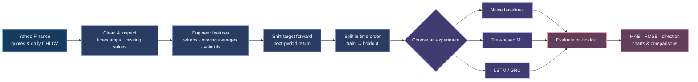

<div align="center">


<br>

### A market lab for curious minds

**Explore market history. Compare forecasting models. See the limits behind every prediction.**

*A practical, interactive stock-analysis project built for learning—not trading advice.*

[Explore the app](#-launch-zephyr) · [See the workflow](#-from-market-data-to-model-score) · [Read the fine print](#-data-models-and-limitations)

<br>

`Python` &nbsp;·&nbsp; `Streamlit` &nbsp;·&nbsp; `Plotly` &nbsp;·&nbsp; `scikit-learn` &nbsp;·&nbsp; `TensorFlow`

</div>

<br>

> [!IMPORTANT]
> **This is an educational research dashboard—not an investment product.** Forecasts are experimental, can be wrong, and should not be used as the basis for financial decisions.

<details>
<summary><strong>Quick navigation</strong>　(⌘ / Ctrl + click a section)</summary>

- [The idea](#-the-idea)
- [What you can explore](#-what-you-can-explore)
- [How the analysis flows](#-from-market-data-to-model-score)
- [Launch Zephyr](#-launch-zephyr)
- [Project map](#-project-map)
- [Tests](#-tests)
- [Data, models, and limitations](#-data-models-and-limitations)
- [News and sentiment modules](#-news-and-sentiment-modules)
- [License](#-license)

</details>

## ✦ The idea

**Zephyr** is a Streamlit dashboard for exploring historical stock data and short-horizon forecasting experiments. Choose a ticker, inspect its OHLCV history, engineer technical features, train baseline or machine-learning models, and compare their results on a *chronological* holdout.

The project favors **inspection over illusion**: it displays model scores alongside the observed-versus-predicted series and keeps the financial disclaimer in view. No model can promise what a market will do next. (｡•̀ᴗ-)✧

### Built around five questions

| Question | Where to look |
|---|---|
| What does the latest available quote look like? | **Overview** |
| What observations are being analyzed? | **Raw Data** |
| What patterns can features and classic models capture? | **Time Series + ML** |
| How do neural networks and model scores compare? | **Neural Networks** · **Performance Metrics** |
| What does the selected model estimate for the next period? | **AI Forecast** |

## ◈ What you can explore

| Dashboard area | What it shows | Models / methods |
|---|---|---|
| **01 · Overview** | Latest available price, daily change, volume, day range, exchange, region, and data age | Yahoo Finance quote/history |
| **02 · Raw Data** | Daily OHLCV history, missing-data summary, cleaning options, and a downloadable CSV | Forward-fill, drop, or leave missing values unchanged |
| **03 · Time Series + ML** | Candlestick chart, feature preview, model comparison, and MAE chart | Naive baselines, Random Forest, Extra Trees, HistGradientBoosting, XGBoost, LightGBM |
| **04 · Neural Networks** | Train/test metrics, loss curves, and predicted-versus-actual returns | LSTM or GRU |
| **05 · Performance Metrics** | Model ranking, MAE and directional-accuracy charts, optional walk-forward scores | Chronological holdout; optional expanding-window validation |
| **06 · AI Forecast** | Holdout metrics, an illustrative next-period return and price, and test-set comparison | Selected baseline or classical ML model |

<p>


</p>

> **A note on the horizon control:** the sidebar offers 1-, 3-, and 5-day selections, but the current AI Forecast implementation predicts a **next-period return**; it does not recursively generate a multi-day path. Treat the displayed horizon as UI context, <mark style="background-color:#473B67;color:#F5F7FC;">not a validated multi-day forecast</mark>.

## ⤷ From market data to model score



### The model shelf

| Family | Available choices | Purpose |
|---|---|---|
| **Baselines** | `NaiveLastClose`, `NaiveLastReturn` | Establish simple reference predictions |
| **Classical ML** | `RandomForest`, `ExtraTrees`, `HistGradientBoosting`, `XGBoost`, `LightGBM` | Compare tree-based regressors on engineered features |
| **Neural networks** | `LSTM`, `GRU` | Experiment with sequence-based return prediction |

**Reported metrics:** mean absolute error (**MAE**), root mean squared error (**RMSE**), and **directional accuracy** (the share of non-zero actual returns whose sign is predicted correctly).

## ◉ Launch Zephyr

### 1 · Prepare Python

Python **3.10 or newer** is a sensible starting point. TensorFlow and other scientific packages may have platform-specific installation requirements; use an environment supported by the versions available for your operating system.

```powershell
py -3.10 -m venv .venv
.\.venv\Scripts\Activate.ps1
python -m pip install --upgrade pip
```

If PowerShell prevents environment activation, run the environment's Python directly instead:

```powershell
.\.venv\Scripts\python.exe -m pip install --upgrade pip
```

### 2 · Install project dependencies

```powershell
python -m pip install -r requirements.txt
```

The requirements include deep-learning and NLP libraries, so setup can be substantial. TensorFlow powers the LSTM/GRU screen; PyTorch is included for the sentiment/transformers modules.

### 3 · Start the dashboard

```powershell
python -m streamlit run app.py
```

Open the local address printed by Streamlit, select a region and ticker in the sidebar, then navigate the six tabs. The app fetches market data at runtime, so **an internet connection and availability from Yahoo Finance are required**.

### 4 · Optional: run tests

The test runner is not listed in `requirements.txt`; install it into the active environment if needed:

```powershell
python -m pip install pytest
python -m pytest -q
```

Tests that fetch live quotes or ticker history depend on network access and Yahoo Finance responses.

## ⌘ Project map

```text
Stock_Market_Analysis/
├── app.py                  # Streamlit entry point and six dashboard tabs
├── config.py               # Project settings, ticker universe, model choices
├── requirements.txt        # Python dependencies
├── assets/
│   └── zephyr-banner.svg   # Project banner
├── data/
│   ├── fetch.py            # Yahoo Finance quotes and OHLCV
│   ├── preprocess.py       # Cleaning and quality checks
│   └── features.py         # Technical features and supervised targets
├── models/
│   ├── baselines.py        # Simple reference models
│   ├── ml_models.py        # Classical ML model factory
│   ├── dl_models.py        # LSTM / GRU sequence models
│   └── train_eval.py       # Splitting, training, metrics, validation
├── ui/                     # Sidebar and the six Streamlit tab views
├── nlp/                    # News retrieval and sentiment helpers
├── utils/                  # Plotting, helper functions, and metrics
├── tests/                  # Data, feature, and metric tests
└── notebooks/
    └── experiments.ipynb   # Experimental analysis notebook
```

## ✓ Tests

The tests cover data cleaning and quality summaries, feature generation and target shifting, and evaluation metrics.

```powershell
python -m pytest -q
```

`tests/test_data.py` also contains live Yahoo Finance checks; those tests may fail when the network, upstream service, or ticker response is unavailable.

## ⚑ Data, models, and limitations

- **Data source:** market history and quotes are fetched through `yfinance` from Yahoo Finance. Availability, coverage, timestamps, and delays are outside this project's control.
- **Ticker coverage:** the configured universe includes selected listings in the United States, United Kingdom, Europe, and Australia. It is not a complete exchange listing.
- **History and interval:** the dashboard requests daily OHLCV history. The data-fetching helper accepts other intervals, but intraday analysis is not the workflow displayed by the current UI.
- **Forecast target:** engineered targets are shifted to the next observation. This is a short-horizon experiment, not a price guarantee.
- **Validation:** comparison screens use an ordered train/test split; optional walk-forward validation is available for selected classical ML models. Neither guarantees future performance.
- **Model choice:** XGBoost and LightGBM are listed in the requirements, but the ML module treats them as optional imports; availability depends on successful installation.
- **Forecast horizon:** choosing 3 or 5 days does not currently roll a one-step model forward for a corresponding multi-step forecast.
- **News sentiment:** sentiment helpers exist in `nlp/`, but the News & Sentiment tab and its sidebar controls are currently removed from the dashboard.
- **No investment guidance:** forecasts may be inaccurate, stale, or misleading. Do your own research and consult a qualified professional where appropriate.

> “The point is not to predict every move. It is to make the experiment—and its uncertainty—visible.”
>
> <sub>Zephyr project note · Please treat model output as a hypothesis, not a signal.</sub>

## ◌ News and sentiment modules

The repository includes helpers for retrieving ticker news from Yahoo Finance and analyzing headlines with **VADER** or **FinBERT**. These modules are supporting code, **not an active dashboard tab**. FinBERT may download its pretrained model on first use; availability depends on network access and the installed `transformers` / PyTorch environment.

## ▣ License

Distributed under the [MIT License](LICENSE).

<div align="center">

<br>

**Made for thoughtful experiments.** &nbsp; `｡･:*:･ﾟ★,｡･:*:･ﾟ☆`

<sub>Less certainty. Better questions. More transparent charts.</sub>

</div>
